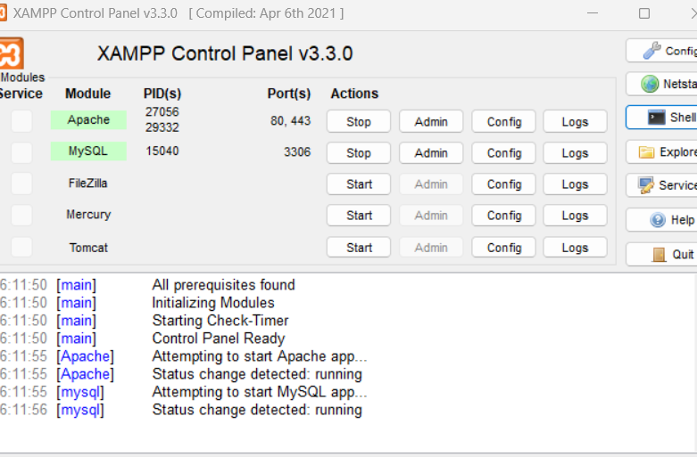
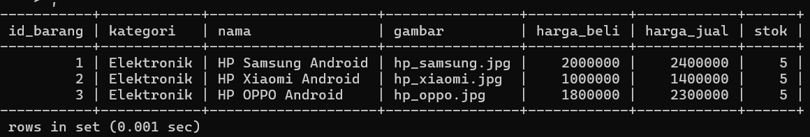
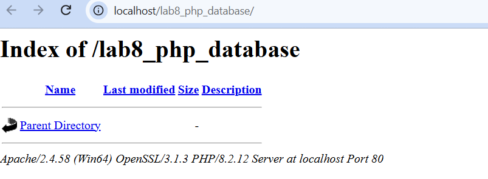
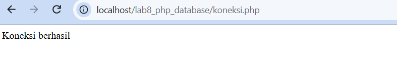
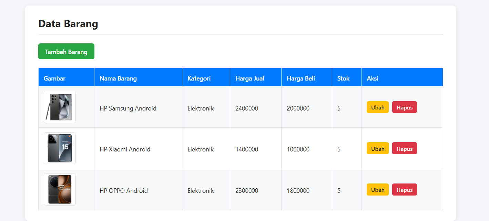
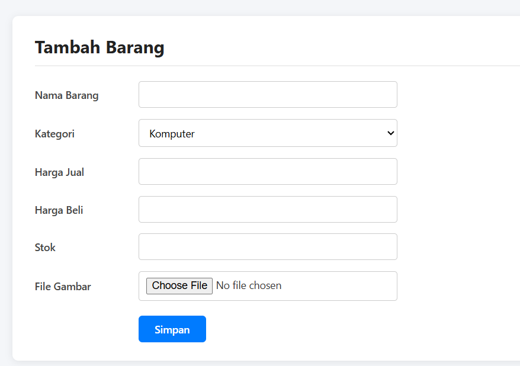
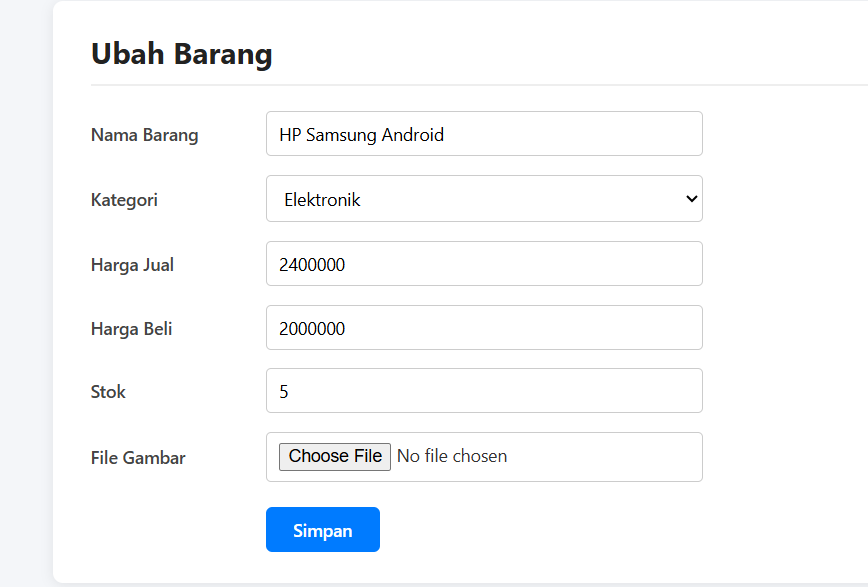

# Praktikum 8 – Aplikasi CRUD PHP dan MySQL

Mata kuliah: Pemrograman Web
Nama: Riksa Siddiq Alrizki | NIM: 312510015 | Kelas: I253A

## 1. Tujuan
- Menjalankan Apache dan MySQL Server melalui XAMPP.
- Membuat database, tabel, dan data awal pada MySQL.
- Menghubungkan PHP dengan database menggunakan `mysqli`.
- Membuat aplikasi CRUD (Create, Read, Update, Delete) sederhana dengan studi kasus Data Barang.
- Mengunggah file gambar barang dan menyimpan lokasinya ke database.

## 2. Perangkat
- XAMPP v3.3.0 (Apache dan MySQL)
- PHP 8.2.12
- Text editor (VS Code)
- Browser (Chrome)

## 3. Persiapan: Menjalankan Apache dan MySQL
Buka **XAMPP Control Panel**, lalu klik **Start** pada **Apache** (port 80, 443) dan **MySQL** (port 3306). Kedua modul berwarna hijau yang menandakan server sudah berjalan.

**Screenshot 1** – XAMPP Control Panel, Apache dan MySQL berjalan


## 4. Membuat Database dan Tabel
Database `latihan1` dan tabel `data_barang` dibuat dengan perintah berikut.

```sql
CREATE DATABASE latihan1;

CREATE TABLE data_barang (
  id_barang  int(10) auto_increment PRIMARY KEY,
  kategori   varchar(30),
  nama       varchar(30),
  gambar     varchar(100),
  harga_beli decimal(10,0),
  harga_jual decimal(10,0),
  stok       int(4)
);
```

Tiga data awal dimasukkan dengan `INSERT INTO data_barang (...) VALUES (...)`: HP Samsung Android, HP Xiaomi Android, dan HP OPPO Android. Hasilnya dicek dengan `SELECT * FROM data_barang;` pada MySQL client. Kolom `id_barang` terisi otomatis (1, 2, 3) karena `auto_increment`.

**Screenshot 2** – Isi tabel `data_barang` pada MySQL


## 5. Menyiapkan Folder Proyek
Folder `lab8_php_database` dibuat di `htdocs` pada direktori XAMPP, lalu diakses melalui `http://localhost/lab8_php_database/`.

**Screenshot 3** – Folder `lab8_php_database` di htdocs


Karena folder masih kosong, Apache menampilkan daftar isi direktori (*Index of*). Ini menandakan folder sudah dikenali web server.

**Screenshot 4** – Folder diakses lewat browser


## 6. Struktur File
```
lab8_php_database/
├── koneksi.php    # koneksi ke database
├── index.php      # Read: menampilkan data barang
├── tambah.php     # Create: menambah data barang
├── ubah.php       # Update: mengubah data barang
├── hapus.php      # Delete: menghapus data barang
├── style.css      # tampilan halaman
├── gambar/        # tempat file gambar barang
├── README.md
└── screenshoot/   # 1.png – 8.png
```

## 7. Hasil dan Penjelasan

### 7.1 Koneksi Database (`koneksi.php`)
File ini memanggil `mysqli_connect()` dengan host `localhost`, user `root`, password kosong, dan database `latihan1`. Jika koneksi gagal, program menampilkan pesan "Koneksi ke server gagal." lalu berhenti dengan `die()`. File ini di-*include* oleh `index.php`, `tambah.php`, `ubah.php`, dan `hapus.php`.
Pengujian dilakukan dengan membuka `koneksi.php` di browser setelah baris `echo "Koneksi berhasil"` diaktifkan. Pesan "Koneksi berhasil" muncul, jadi PHP berhasil terhubung ke MySQL.

**Screenshot 5** – Tes koneksi database


### 7.2 Menampilkan Data – Read (`index.php`)
`index.php` menjalankan `SELECT * FROM data_barang`, lalu setiap barisnya ditampilkan dengan `while (mysqli_fetch_array(...))` ke dalam tabel HTML. Kolom yang ditampilkan adalah gambar, nama barang, kategori, harga jual, harga beli, stok, dan aksi (tombol **Ubah** dan **Hapus**). Jika tabel kosong, tampil pesan "Belum ada data". Tombol **Tambah Barang** mengarah ke `tambah.php`.

**Screenshot 6** – Halaman Data Barang


### 7.3 Menambah Data – Create (`tambah.php`)
Form berisi nama barang, kategori (pilihan Komputer, Elektronik, Hand Phone), harga jual, harga beli, stok, dan file gambar. Form memakai `method="post"` dan `enctype="multipart/form-data"` supaya file bisa diunggah. Alurnya:
1. Data teks diambil dari `$_POST`, file dari `$_FILES['file_gambar']`.
2. Jika file berhasil dikirim (`error == 0`), spasi pada nama file diganti `_` lalu file dipindahkan ke folder `gambar/` dengan `move_uploaded_file()`.
3. Data disimpan dengan perintah `INSERT INTO data_barang ...`.
4. Pengguna diarahkan kembali ke `index.php` dengan `header('location: index.php')`.

**Screenshot 7** – Form Tambah Barang


### 7.4 Mengubah Data – Update (`ubah.php`)
Halaman dibuka dengan parameter `id` (`ubah.php?id=1`). Program mengambil data barang tersebut dengan `SELECT ... WHERE id_barang = ...` dan mengisi form dengan nilai lamanya. ID barang dikirim lewat input `hidden`. Saat disimpan, `UPDATE data_barang SET ... WHERE id_barang = ...` dijalankan. Kolom `gambar` hanya diperbarui jika pengguna memilih file baru, sehingga gambar lama tidak hilang bila file tidak diganti. Kategori yang tersimpan otomatis terpilih pada dropdown lewat fungsi `is_select()`.

**Screenshot 8** – Form Ubah Barang (data HP Samsung Android)


### 7.5 Menghapus Data – Delete (`hapus.php`)
Tombol **Hapus** memanggil `hapus.php?id=...`. File ini mengambil `id` dari `$_GET`, menjalankan `DELETE FROM data_barang WHERE id_barang = ...`, lalu mengarahkan pengguna kembali ke `index.php`. Setelah data terhapus, barisnya hilang dari tabel.

## 8. Ringkasan Operasi CRUD
| Operasi | File | Perintah SQL | Metode |
|---|---|---|---|
| Create | `tambah.php` | `INSERT INTO` | POST |
| Read | `index.php` | `SELECT` | – |
| Update | `ubah.php` | `UPDATE ... WHERE` | GET (ambil data), POST (simpan) |
| Delete | `hapus.php` | `DELETE ... WHERE` | GET |

## 9. Catatan
- Pada kode modul, nilai dari form langsung disisipkan ke query SQL. Cara ini rentan terhadap **SQL injection**. Untuk aplikasi sungguhan, gunakan *prepared statement* (`mysqli_prepare`/`bind_param`) dan validasi input di sisi server.
- Menghapus data lewat tautan GET tanpa konfirmasi mudah memicu penghapusan tidak sengaja. Sebaiknya ditambah dialog konfirmasi atau memakai POST.
- Data yang ditampilkan dengan `echo` sebaiknya dibungkus `htmlspecialchars()` untuk mencegah XSS.

## 10. Kesimpulan
Aplikasi CRUD Data Barang berhasil dibuat dengan PHP dan MySQL di XAMPP. Koneksi database berjalan, dan data dapat ditampilkan, ditambah (termasuk unggah gambar), diubah, dan dihapus. Praktikum ini menunjukkan alur dasar aplikasi web dinamis: form mengirim data, PHP memprosesnya ke database, lalu hasilnya ditampilkan kembali ke pengguna.
